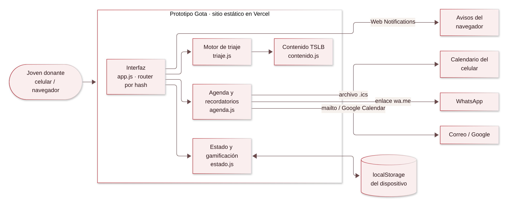
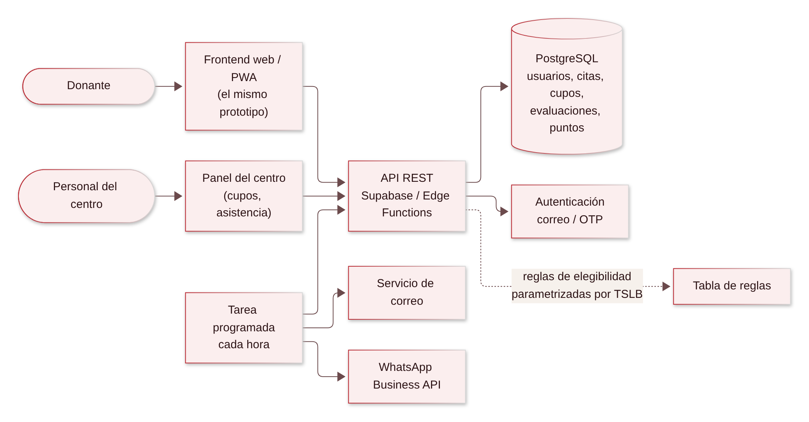

# Semana 1 · Integración y Diagnóstico Inicial

**Periodo:** 19 al 24 de octubre · **Equipo:** Ingeniería de Sistemas, con aportes de TSLB

**Entregable Sistemas:** diagrama de arquitectura y Product Backlog inicial con usuarios objetivo.
**Entregable conjunto:** equipos formados, acuerdos, tablero Padlet y glosario compartido Salud/Software.
**Criterio de aceptación:** requisitos sanitarios con fuente normativa citada y Product Backlog con historias de usuario revisadas por TSLB.

> **Cómo usar este documento.** Las secciones marcadas con **[Completar]** necesitan datos que solo tiene el equipo (nombres, fechas, enlaces). Las marcadas con **[Validar TSLB]** son propuestas de Sistemas que el equipo de salud debe revisar y aprobar.

## 1. Contexto del problema

En Chile, una parte importante de las donaciones proviene de donantes de reposición (familiares o conocidos de un paciente) y no de donantes altruistas habituales **[Validar TSLB: agregar la cifra actual con su fuente]**. El público joven (17 a 25 años) puede tener disposición a donar, pero en la práctica se encuentra con barreras como estas tres que este proyecto ataca desde la tecnología:

1. **Incertidumbre:** no sabe si cumple los requisitos ("¿con tatuaje puedo?", "¿tengo que ir en ayunas?").
2. **Fricción:** agendar exige llamar o ir sin saber si habrá atención.
3. **Olvido y desconexión:** no hay recordatorio previo ni seguimiento para volver a donar.

Los mitos, creencias y barreras juveniles los identifica y documenta el equipo TSLB (entregable TSLB de esta semana).

## 2. Necesidades funcionales de la plataforma

| ID | Necesidad | Origen |
|---|---|---|
| NF-01 | Autoevaluación orientativa de requisitos (triaje express de ~1 minuto) basada en el cuestionario de TSLB. | Barrera de incertidumbre |
| NF-02 | Resultado claro con el siguiente paso (agendar, esperar, consultar a un profesional). | Honestidad sanitaria |
| NF-03 | Agendamiento de hora por lugar, día y hora, con cupos. | Barrera de fricción |
| NF-04 | Recordatorios antes de la cita (preparación) y después (cuidados y volver a donar). | Barrera de olvido |
| NF-05 | Cálculo del intervalo entre donaciones (más de 3 meses hombres, más de 4 meses mujeres). | Fidelización |
| NF-06 | Contenidos educativos: mitos y realidades, cuidados antes y después. | Barrera de mitos |
| NF-07 | Gamificación: puntos, niveles e insignias para motivar acciones clave. | Motivación juvenil |
| NF-08 | Registro mínimo de datos con consentimiento explícito. | Privacidad |
| NF-09 | Funcionar bien en celular (principal dispositivo del público). | Contexto de uso |

**Requisitos no funcionales**

| ID | Requisito |
|---|---|
| RNF-01 | Accesibilidad WCAG 2.1 AA: contraste, foco visible, objetivos táctiles de 44 px, lector de pantalla. |
| RNF-02 | Privacidad: las respuestas sensibles del cuestionario no se almacenan; solo el resultado. |
| RNF-03 | Rendimiento: carga inicial rápida en red móvil (sitio estático, sin frameworks pesados). |
| RNF-04 | Aviso legal visible: el cuestionario no reemplaza la entrevista ni la evaluación profesional. |
| RNF-05 | Idioma español de Chile, tono cercano, lenguaje inclusivo en formularios. |

## 3. Perfiles de usuario (personas)

**Camila, 20 años — estudiante, nunca ha donado.** Quiere ayudar porque vio una campaña en redes, pero tiene un piercing reciente y no sabe si puede. Usa el celular para todo y no va a llamar por teléfono. *Necesita:* saber en un minuto si puede y agendar sin hablar con nadie.

**Diego, 23 años — donó una vez por un familiar.** Le fue bien, pero nadie le avisó cuándo podía volver. *Necesita:* que la plataforma le calcule la fecha y se la recuerde.

**Valentina, 17 años — estudiante de cuarto medio.** Quiere donar en la campaña de su colegio. *Necesita:* saber que con 17 años puede donar con autorización escrita de su madre, padre o tutor, y que se lo recuerden el día de la cita.

**Profesional del centro de donación (usuario secundario).** *Necesita:* que las personas lleguen preparadas (documento, haber comido, dormido) y con expectativas correctas sobre la entrevista.

## 4. Propuesta de valor

> **Del "¿podré?" a tener hora, en una sola visita.** Una autoevaluación de un minuto, basada en los requisitos que valida el equipo de salud, que termina en una hora agendada y recordatorios, y que te avisa cuándo puedes volver a donar.

Lo que la diferencia de un formulario genérico: replica el árbol de decisión sanitario de TSLB, siempre explica el siguiente paso, y está pensada para fidelizar (volver a donar), no solo para captar.

## 5. Historias de usuario con criterios de aceptación

Formato: *Como [rol], quiero [acción], para [beneficio].* Criterios en formato Dado / Cuando / Entonces. Prioridad MoSCoW (M = must, S = should, C = could).

**HU-01 · Autoevaluación (M, 8 pts)**
Como joven interesado/a, quiero responder preguntas simples de sí o no sobre los requisitos, para saber si puedo donar antes de ir.

- Dado que inicio la autoevaluación, cuando respondo, entonces veo una pregunta por pantalla con respuestas grandes y la etapa en que voy.
- Dado que respondo "No" en un requisito general (documento, edad, peso, sueño y comida, intervalo), entonces la autoevaluación termina y veo el resultado correspondiente del árbol de decisión.
- Dado que respondo todas las preguntas, cuando acepto la declaración de la Etapa 5, entonces veo mi resultado.
- Puedo volver a la pregunta anterior sin perder lo respondido.

**HU-02 · Resultado orientativo (M, 5 pts)**
Como joven, quiero entender mi resultado y qué hacer después, para no quedar con dudas.

- El resultado usa un lenguaje claro, indica el siguiente paso y muestra siempre el aviso: "no reemplaza la entrevista ni la evaluación profesional".
- Si hay criterios de exclusión, veo cuáles fueron, sin juicios.
- Si el resultado lo permite, veo el botón "Agendar mi hora".

**HU-03 · Registro mínimo (M, 3 pts)**
Como joven, quiero dejar solo los datos necesarios, para agendar sin un formulario largo.

- Solo el nombre y el sexo (para el intervalo) son obligatorios; correo y WhatsApp son opcionales.
- Debo aceptar el consentimiento de uso de datos.
- Los errores se muestran junto al campo y explican cómo corregirlos.

**HU-04 · Agendamiento (M, 8 pts)**
Como joven, quiero elegir lugar, día y hora disponibles, para reservar sin llamar.

- Veo solo los días de atención del lugar y las horas con cupos libres.
- No puedo tener dos horas activas a la vez.
- Al confirmar, recibo un código de reserva.

**HU-05 · Recordatorios (M, 5 pts)**
Como joven, quiero recordatorios antes de mi cita, para no olvidarla y llegar preparado/a.

- Puedo agregar la cita a mi calendario con alarmas (día antes y 2 horas antes), enviármela por WhatsApp o correo.
- Los recordatorios incluyen lo que debo cumplir: dormir 5 horas, comer, llevar documento (y autorización si corresponde).

**HU-06 · Reprogramar o cancelar (S, 3 pts)**
Como joven, quiero cambiar o cancelar mi hora, para liberar el cupo si no puedo ir.

**HU-07 · Volver a donar (S, 5 pts)**
Como donante, quiero que la plataforma calcule cuándo puedo volver, para donar de forma habitual.

- Después de la fecha de la cita, la plataforma me pregunta si doné.
- Si doné, calcula la fecha: más de 3 meses (hombres) o 4 meses (mujeres), y me ofrece guardarla en el calendario.

**HU-08 · Mitos y realidades (S, 3 pts)**
Como joven, quiero ponerme a prueba con mitos comunes, para informarme de forma entretenida.

**HU-09 · Guías antes y después (S, 2 pts)**
Como joven, quiero saber cómo prepararme y cuidarme después de donar.

**HU-10 · Gamificación (C, 5 pts)**
Como joven, quiero ganar puntos e insignias por informarme, agendar y donar, para sentir progreso.

**HU-11 · Compartir (C, 2 pts)**
Como donante, quiero invitar a otras personas, para sumar donantes.

**HU-12 · Privacidad y borrado (M, 2 pts)**
Como persona usuaria, quiero borrar mis datos cuando quiera y saber que mis respuestas sensibles no se guardan.

## 6. Product Backlog inicial (priorizado)

| Prioridad | ID | Historia | MoSCoW | Puntos | Sprint previsto |
|---|---|---|---|---|---|
| 1 | HU-01 | Autoevaluación | Must | 8 | S2 (lógica) – S3 (implementación) |
| 2 | HU-02 | Resultado orientativo | Must | 5 | S3 |
| 3 | HU-04 | Agendamiento | Must | 8 | S3 |
| 4 | HU-03 | Registro mínimo | Must | 3 | S3 |
| 5 | HU-05 | Recordatorios | Must | 5 | S3 |
| 6 | HU-12 | Privacidad y borrado | Must | 2 | S3 |
| 7 | HU-07 | Volver a donar | Should | 5 | S3 |
| 8 | HU-06 | Reprogramar o cancelar | Should | 3 | S4 |
| 9 | HU-08 | Mitos y realidades | Should | 3 | S3 |
| 10 | HU-09 | Guías antes y después | Should | 2 | S3 |
| 11 | HU-10 | Gamificación | Could | 5 | S3 |
| 12 | HU-11 | Compartir | Could | 2 | S4 |
| — | HU-13 | Panel del centro (gestión de cupos y asistencia) | Won't (esta versión) | 13 | Futuro |
| — | HU-14 | Envío automático de correo/WhatsApp desde servidor | Won't (esta versión) | 8 | Futuro |

**Total comprometido para el prototipo:** 51 puntos de historia.

## 7. Diagrama preliminar de arquitectura

La arquitectura se definió en dos niveles: lo que se construye en el COIL (prototipo funcional sin servidor) y la arquitectura objetivo para una versión real.

**Arquitectura del prototipo (lo que se construye en 5 semanas).** Sitio web estático publicado en Vercel. Toda la lógica corre en el navegador del celular y los datos quedan en el dispositivo (localStorage). Los recordatorios se entregan con los canales que el teléfono ya tiene: calendario (.ics), WhatsApp, correo y avisos del navegador.

**Arquitectura objetivo (siguiente etapa).** Backend con base de datos PostgreSQL (por ejemplo, Supabase), autenticación, panel del centro de donación y una tarea programada que envía los recordatorios por correo y WhatsApp Business. Las reglas de elegibilidad se guardan como tabla parametrizable, para que el equipo de salud pueda actualizarlas sin programar.

**Decisiones de arquitectura**

| Decisión | Alternativa descartada | Motivo |
|---|---|---|
| Sitio estático (HTML, CSS, JavaScript) | Framework (React, Flutter) | 5 semanas, despliegue simple en Vercel, carga rápida en celular, sin dependencias. |
| Datos en el dispositivo (localStorage) | Base de datos en la nube | Sin datos sensibles en servidores durante el piloto; cero costo; suficiente para demostrar el flujo completo. |
| Motor de triaje como módulo puro (sin interfaz) | Lógica mezclada con la pantalla | Permite probar el árbol de decisión con pruebas automáticas y cambiar las preguntas sin tocar la interfaz. |
| Recordatorios por .ics, WhatsApp y correo | Servidor de envío automático | No requiere backend ni cuentas de pago; el calendario del celular avisa aunque la app esté cerrada. |

## 8. Entregable conjunto

### 8.1 Equipos formados **[Completar]**

| Integrante | Programa | Rol en el equipo | Contacto |
|---|---|---|---|
| | TSLB | Contenido sanitario / requisitos | |
| | TSLB | Contenidos educativos y campaña | |
| | TSLB | Validación clínica y casos de prueba | |
| | Ing. de Sistemas | Desarrollo y arquitectura | |
| | Ing. de Sistemas | UX/UI y pruebas | |

### 8.2 Acuerdos de trabajo (propuesta)

1. **Comunicación:** grupo de WhatsApp para coordinación diaria; Padlet como fuente oficial de avances y entregables.
2. **Reuniones:** una sincrónica por semana (considerar diferencia horaria Chile–Colombia) y avances asincrónicos en el Padlet.
3. **Responsabilidades:** TSLB es dueño del contenido sanitario (nada sanitario se publica sin su validación); Sistemas es dueño de la plataforma y su funcionamiento.
4. **Plazos:** cada entregable se sube al Padlet a más tardar el último día de su semana.
5. **Decisiones:** por consenso; si no lo hay, decide el área dueña del tema (salud o software).
6. **Respeto y lenguaje:** sin tecnicismos sin explicar; cada área explica sus términos (ver glosario).

### 8.3 Estructura sugerida del tablero Padlet

| Columna | Contenido |
|---|---|
| Equipo y acuerdos | Integrantes, roles, acuerdos, horarios. |
| Semana 1 | Requerimientos técnicos (TSLB), arquitectura y backlog (Sistemas), glosario. |
| Semana 2 | Guion de autoevaluación y árbol (TSLB), wireframes y modelo de datos (Sistemas). |
| Semana 3 | Banco de contenidos (TSLB), prototipo funcional (Sistemas). |
| Semana 4 | Casos clínicos y validación (TSLB), versión corregida y pruebas (Sistemas). |
| Semana 5 | Pitch, demo e informe final. |
| Enlaces | Prototipo publicado, repositorio, documentos. |

### 8.4 Glosario compartido Salud / Software

| Término | Área | Definición en palabras simples |
|---|---|---|
| Donación altruista | Salud | Donación voluntaria, sin pago y sin estar destinada a un paciente específico. |
| Donante de reposición | Salud | Persona que dona para "reponer" la sangre usada por un familiar o conocido. |
| Diferimiento | Salud | Postergación de la donación por un tiempo; la persona podrá donar más adelante. |
| Diferimiento temporal | Salud | Diferimiento por un periodo definido (por ejemplo, el intervalo entre donaciones). |
| Contraindicación / exclusión | Salud | Condición que impide donar, por un tiempo o de forma permanente, según criterio profesional. |
| Criterio de exclusión | Salud | Situación del cuestionario que obliga a esperar antes de donar (nodo M del árbol). |
| Entrevista predonación | Salud | Conversación confidencial con un profesional antes de donar. |
| Hemoglobina | Salud | Proteína de los glóbulos rojos; se controla antes de donar. |
| Componentes sanguíneos | Salud | Partes en que se separa la sangre donada: glóbulos rojos, plasma y plaquetas. |
| Intervalo entre donaciones | Salud | Tiempo mínimo entre una donación y otra: más de 3 meses (hombres) o 4 meses (mujeres). |
| Triaje | Ambas | Clasificación inicial para orientar el siguiente paso; aquí, la autoevaluación. |
| Árbol de decisión | Ambas | Diagrama de preguntas y caminos que lleva a un resultado; se traduce a lógica de programa. |
| Historia de usuario | Software | Descripción corta de algo que una persona necesita hacer en la plataforma. |
| Criterio de aceptación | Software | Condición verificable para dar por terminada una historia de usuario. |
| Product Backlog | Software | Lista priorizada de todo lo que se quiere construir. |
| MVP | Software | Producto mínimo viable: la versión más simple que ya entrega valor y se puede probar. |
| Prototipo | Software | Versión de prueba para validar ideas con usuarios antes del producto final. |
| Wireframe / mockup | Software | Boceto de pantallas: el wireframe es esquemático; el mockup, con diseño visual. |
| Frontend / backend | Software | La parte que ve la persona / la parte que corre en el servidor (datos, envíos). |
| Despliegue (deploy) | Software | Publicar la aplicación en internet para que otras personas la usen. |
| Staging / demo | Software | Entorno de pruebas publicado, separado de la versión final. |
| UAT | Software | Pruebas de aceptación de usuario: personas reales verifican que la plataforma cumple. |
| localStorage | Software | Espacio de almacenamiento del navegador del propio celular. |
| Gamificación | Software | Uso de puntos, niveles e insignias para motivar acciones. |

## 9. Insumos que se recibieron de TSLB **[Validar TSLB]**

- Cuestionario "Autoevaluación previa a la donación de sangre" (Etapas 1 a 5).
- Árbol de decisión (flowchart A a W).
- Pendiente para cumplir el criterio de aceptación: **la cita de la fuente normativa** (Norma MINSAL Chile correspondiente) para cada requisito. Sistemas dejó cada requisito trazado a su pregunta para que TSLB agregue la fuente exacta.
