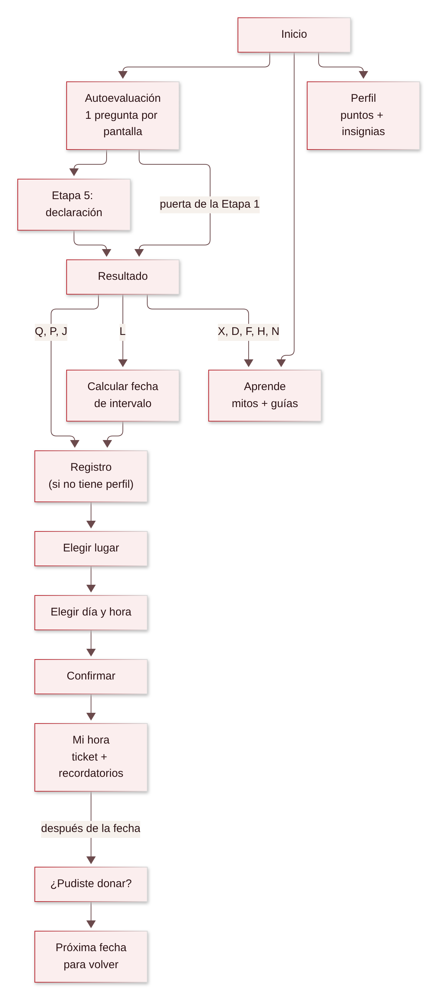
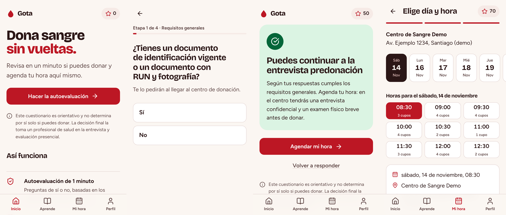
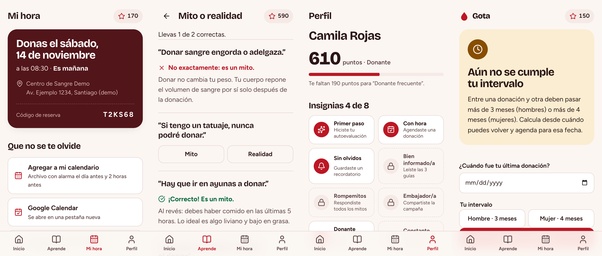
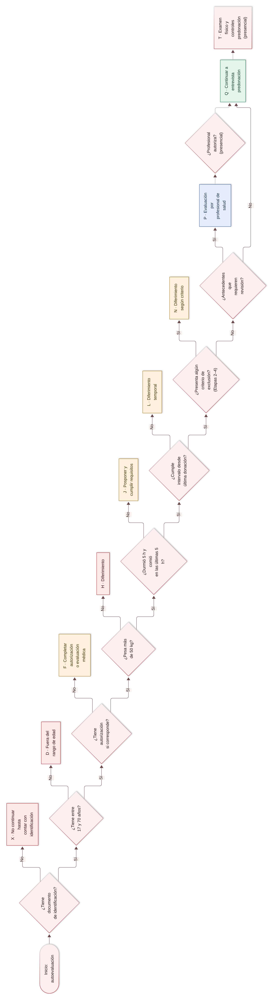
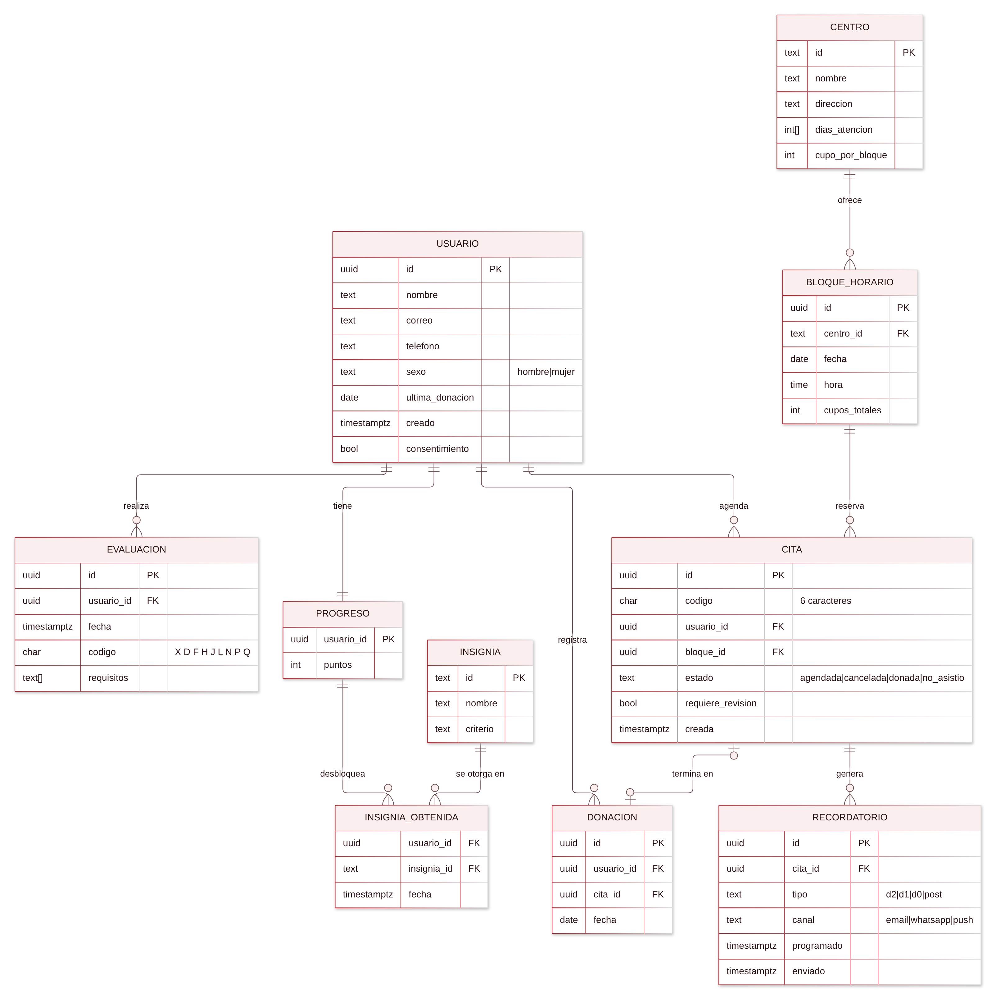

# Semana 2 · Diseño de la Experiencia y Estrategia de Motivación

**Periodo:** 26 al 31 de octubre · **Equipo:** Ingeniería de Sistemas, con aportes de TSLB

**Entregable Sistemas:** prototipo visual inicial (wireframes/mockups) y modelo de datos estructurado.
**Entregable conjunto:** diseño preliminar de plataforma y validación interdisciplinaria de funcionalidades.
**Criterio de aceptación:** el árbol de decisión cubre los requisitos generales (Semana 1) y los wireframes están validados por ambos grupos.

## 1. Principios de experiencia (resultado del taller de codiseño)

1. **Un minuto.** Una pregunta por pantalla, respuestas grandes de Sí/No, sin botón "Siguiente": tocar la respuesta avanza.
2. **Honestidad sanitaria.** Orientar, nunca dictaminar. Cada resultado dice qué hacer después y recuerda que decide un profesional.
3. **Sin juicio en lo sensible.** Las preguntas de las Etapas 3 y 4 explican por qué se hacen y aclaran que las respuestas no se guardan.
4. **Del interés a la cita.** El resultado lleva directo a agendar, sin volver a empezar.
5. **Volver a donar.** La experiencia no termina en la cita: pregunta si donaste y te dice cuándo puedes volver.

## 2. Estructura de navegación

Cuatro secciones en una barra inferior (patrón conocido en apps móviles): **Inicio**, **Aprende**, **Mi hora** y **Perfil**. Durante la autoevaluación la barra se oculta para que nada distraiga.



## 3. Wireframes y mockups

El prototipo visual se construyó directamente en HTML (mockup navegable), lo que permitió validarlo en el celular de cada integrante en lugar de en imágenes estáticas. Pantallas principales:

| Pantalla | Propósito | Elementos clave |
|---|---|---|
| Inicio | Invitar a empezar | Mensaje principal, botón "Hacer la autoevaluación", aviso legal, cómo funciona en 4 pasos. |
| Pregunta | Responder rápido | Etapa y barra de avance, pregunta grande, ayuda breve, opciones de toda la anchura. |
| Declaración (Etapa 5) | Confirmar veracidad | Casilla obligatoria con el texto de TSLB. |
| Resultado | Entender el siguiente paso | Color según tipo de resultado, explicación, motivos, requisitos, botón de acción. |
| Registro | Datos mínimos | Nombre, correo y WhatsApp opcionales, sexo (para el intervalo), consentimiento. |
| Lugar / día y hora | Agendar | Lista de lugares, carrusel de días, grilla de horas con cupos, resumen. |
| Mi hora | No olvidar | Ticket con código, canales de recordatorio, lista de recordatorios, cambiar o cancelar. |
| Aprende | Informarse | Mito o realidad (quiz), guías paso a paso. |
| Perfil | Ver progreso | Puntos, nivel, insignias, datos, historial, borrar datos. |





**Sistema visual.** Fondo papel cálido, tinta rojo oscuro y un único acento rojo sangre, usado solo para lo que importa (acción principal, progreso). Tipografías Bricolage Grotesque (títulos) y Figtree (texto), ambas de licencia libre. Iconos Lucide con un solo grosor de trazo. Colores de resultado: verde (puedes continuar), azul (revisión profesional), ámbar (esperar o posponer) y rojo (no corresponde por ahora).

## 4. Traducción del árbol de decisión TSLB a lógica de aplicación

El flowchart entregado por TSLB (nodos A a W) se tradujo al motor `triaje.js`. Los nodos B, C, E, G, I y K son **puertas secuenciales**: la primera respuesta que no cumple termina la autoevaluación. Las Etapas 2 a 4 alimentan los nodos M (criterio de exclusión) y O (requiere revisión), que se evalúan al final en ese orden: **la exclusión tiene prioridad sobre la revisión.** Los nodos R, T, U, V y W ocurren de forma presencial y quedan fuera de la plataforma (se informan en el resultado).



### 4.1 Tabla de resultados

| Código | Nodo TSLB | Mensaje en la app | ¿Permite agendar? |
|---|---|---|---|
| X | No continuar hasta contar con identificación | Primero consigue tu identificación | No |
| D | Diferimiento / fuera del rango de edad | Estás fuera del rango de edad para donar | No |
| F | Completar autorización o evaluación médica | Te falta la autorización escrita | No |
| H | Diferimiento (peso) | Por ahora no corresponde donar | No |
| J | Posponer y cumplir requisitos | Hoy no, pero puedes agendar otro día | Sí (otro día) |
| L | Diferimiento temporal (intervalo) | Aún no se cumple tu intervalo | Sí, desde la fecha calculada |
| N | Diferimiento según criterio | Por ahora es mejor esperar | No |
| P | Evaluación por profesional de salud | Puedes agendar: un profesional revisará tu caso | Sí, marcada para revisión |
| Q | Continuar a entrevista predonación | Puedes continuar a la entrevista predonación | Sí |

### 4.2 Clasificación de cada pregunta **[Validar TSLB]**

El cuestionario de TSLB no indica, para cada pregunta de las Etapas 2 a 4, si es criterio de exclusión (M) o antecedente que requiere revisión (O). Sistemas propone esta clasificación; **TSLB debe confirmarla o corregirla** (cambiarla es modificar una sola línea en `contenido.js`).

| Etapa | Pregunta | Si responde "Sí" | Nodo |
|---|---|---|---|
| 2 | ¿Actualmente te encuentras enfermo/a o presentas algún síntoma? | Exclusión | M |
| 2 | ¿Fiebre o diarrea en los últimos 14 días? | Exclusión | M |
| 2 | ¿Antibióticos en los últimos 7 días? | Exclusión | M |
| 2 | ¿Consumes medicamentos actualmente? | Revisión profesional | O |
| 2 | ¿Tienes alguna enfermedad crónica? | Revisión profesional | O |
| 2 | ¿Has sido operado/a durante los últimos meses? | Revisión profesional | O |
| 2 | ¿Tratamiento dental en los últimos 7 días? | Exclusión | M |
| 2 | ¿Endoscopía o colonoscopía en los últimos 6 meses? | Exclusión | M |
| 2 | ¿Embarazo, parto o aborto en los últimos 6 meses? | Exclusión | M |
| 3 | ¿Tatuajes, piercings o acupuntura en los últimos 6 meses? | Exclusión | M |
| 3 | ¿Has consumido o te has inyectado drogas ilegales? | Exclusión | M |
| 3 | ¿Viaje fuera de Chile en los últimos meses? | Revisión profesional | O |
| 3 | ¿Has vivido en zonas con riesgo de malaria? | Revisión profesional | O |
| 3 | ¿Exposición a sangre de otra persona o accidentes con agujas? | Exclusión | M |
| 4 | ¿Pareja sexual nueva en los últimos 6 meses? | Exclusión | M |
| 4 | ¿Más de una pareja sexual en los últimos 6 meses? | Exclusión | M |
| 4 | ¿Relaciones con personas que ejercen comercio sexual (12 meses)? | Exclusión | M |

### 4.3 Decisiones de diseño que TSLB debe revisar **[Validar TSLB]**

1. **Edad como pregunta de opciones.** "¿Tienes entre 17 y 70 años?" se presenta como cinco opciones (menos de 17, 17, 18–59, 60–70, más de 70) para activar la pregunta de autorización solo cuando corresponde (17 años) y no pedir la fecha de nacimiento.
2. **60 a 70 años.** La autorización la da el médico del lugar de donación, así que la persona no la tiene de antemano: la app permite agendar y marca el caso como "evaluación por profesional" (P), recordando la autorización.
3. **Sueño y comida (J).** Se refieren al día de la donación. Si alguien hace la autoevaluación días antes, la app permite agendar y lo recuerda la noche anterior y 2 horas antes.
4. **Pregunta de embarazo.** Se muestra a todas las personas con la opción "No / no aplica", en vez de preguntar el sexo antes.
5. **Intervalo.** Además de Sí/No, se agrega "Nunca he donado". Si no se cumple, la app calcula la fecha: un día después de cumplir 3 meses (hombres) o 4 meses (mujeres), porque el requisito dice "más de".
6. **Privacidad.** Las respuestas no se guardan: solo el código del resultado y la fecha.

## 5. Modelo de datos

El modelo se diseñó para la versión con servidor (arquitectura objetivo). En el prototipo, las mismas entidades se guardan en el dispositivo como un objeto JSON con la misma estructura.



### 5.1 Diccionario de datos

| Entidad | Descripción | Campos clave |
|---|---|---|
| USUARIO | Persona registrada | nombre, correo (opcional), teléfono (opcional), sexo (para intervalo), última donación, consentimiento |
| EVALUACION | Resultado de cada autoevaluación (sin respuestas) | fecha, código (X D F H J L N P Q), requisitos |
| CENTRO | Lugar de donación | nombre, dirección, días de atención, cupo por bloque |
| BLOQUE_HORARIO | Hora ofrecida por un centro en un día | fecha, hora, cupos totales |
| CITA | Reserva de una persona | código de 6 caracteres, estado (agendada, cancelada, donada, no asistió), requiere revisión |
| RECORDATORIO | Aviso programado de una cita | tipo (2 días antes, día antes, mismo día, después), canal, programado, enviado |
| DONACION | Donación confirmada | fecha, cita asociada |
| PROGRESO / INSIGNIA | Gamificación | puntos, insignias obtenidas |

### 5.2 Esquema SQL de referencia (PostgreSQL)

```sql
create table usuario (
  id uuid primary key default gen_random_uuid(),
  nombre text not null check (length(nombre) between 2 and 60),
  correo text,
  telefono text,
  sexo text not null check (sexo in ('hombre','mujer')),
  ultima_donacion date,
  consentimiento boolean not null default false,
  creado timestamptz not null default now()
);

create table evaluacion (
  id uuid primary key default gen_random_uuid(),
  usuario_id uuid references usuario(id) on delete cascade,
  fecha timestamptz not null default now(),
  codigo char(1) not null check (codigo in ('X','D','F','H','J','L','N','P','Q')),
  requisitos text[] not null default '{}'
);

create table centro (
  id text primary key,
  nombre text not null,
  direccion text not null,
  dias_atencion int[] not null,
  cupo_por_bloque int not null check (cupo_por_bloque > 0)
);

create table bloque_horario (
  id uuid primary key default gen_random_uuid(),
  centro_id text not null references centro(id),
  fecha date not null,
  hora time not null,
  cupos_totales int not null,
  unique (centro_id, fecha, hora)
);

create table cita (
  id uuid primary key default gen_random_uuid(),
  codigo char(6) not null unique,
  usuario_id uuid not null references usuario(id) on delete cascade,
  bloque_id uuid not null references bloque_horario(id),
  estado text not null default 'agendada'
    check (estado in ('agendada','cancelada','donada','no_asistio')),
  requiere_revision boolean not null default false,
  creada timestamptz not null default now()
);
-- Una sola cita activa por persona
create unique index una_cita_activa on cita (usuario_id) where estado = 'agendada';

create table recordatorio (
  id uuid primary key default gen_random_uuid(),
  cita_id uuid not null references cita(id) on delete cascade,
  tipo text not null check (tipo in ('d2','d1','d0','post')),
  canal text not null check (canal in ('email','whatsapp','push')),
  programado timestamptz not null,
  enviado timestamptz
);

create table donacion (
  id uuid primary key default gen_random_uuid(),
  usuario_id uuid not null references usuario(id) on delete cascade,
  cita_id uuid references cita(id),
  fecha date not null
);
```

## 6. Estrategia de motivación (gamificación)

La gamificación premia las acciones que llevan a donar, no el tiempo en la app.

| Acción | Puntos |
|---|---|
| Completar la autoevaluación | 50 |
| Crear el perfil | 20 |
| Agendar una hora | 100 |
| Guardar un recordatorio | 20 |
| Leer una guía | 10 |
| Acertar un mito | 10 |
| Compartir la campaña | 30 |
| Registrar una donación | 300 |

**Niveles:** Curioso/a (0) → Comprometido/a (150) → Donante (400) → Donante frecuente (800).

**Insignias:** Primer paso, Con hora, Sin olvidos, Bien informado/a, Rompemitos, Embajador/a, Donante, Constante.

Los mensajes de sensibilización y los mitos los aporta TSLB (entregable "propuesta de contenidos/motivación"); la app los muestra con un aviso de "contenido en revisión" hasta su validación.

## 7. Validación interdisciplinaria **[Completar]**

| Funcionalidad / pantalla | Revisado por TSLB | Revisado por Sistemas | Observaciones | Estado |
|---|---|---|---|---|
| Árbol de decisión → lógica (sección 4) | | | | Pendiente |
| Clasificación M / O (sección 4.2) | | | | Pendiente |
| Wireframes del cuestionario | | | | Pendiente |
| Pantallas de resultado (textos) | | | | Pendiente |
| Agendamiento | | | | Pendiente |
| Mitos y guías | | | | Pendiente |
