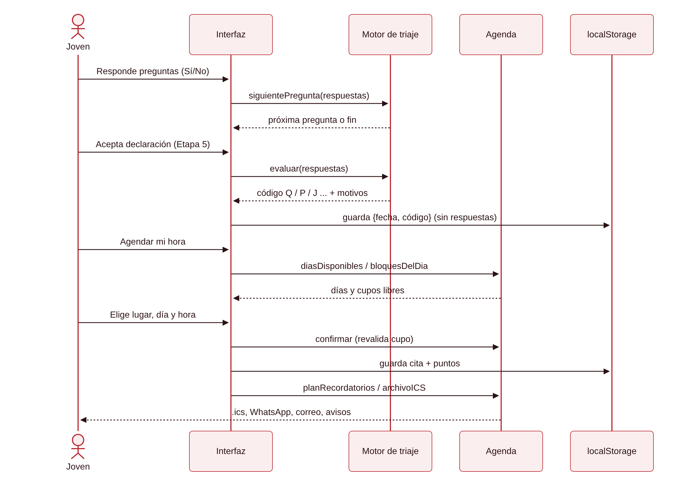

# Semana 3 · Desarrollo de la Solución Digital

**Periodo:** 2 al 7 de noviembre (festivo en Colombia: 2 de noviembre) · **Equipo:** Ingeniería de Sistemas

**Entregable Sistemas:** primera versión funcional del prototipo web con agendamiento y recordatorios.
**Entregable conjunto:** versión inicial de la plataforma con contenidos, motivación y agendamiento básico.
**Criterio de aceptación:** flujo completo (registro, autoevaluación, agendamiento, recordatorio) funciona de extremo a extremo.

## 1. Qué se construyó

**Gota** es una aplicación web móvil (nombre provisional, a confirmar por el equipo). Funciona en cualquier navegador de celular o computador, sin instalar nada, y puede agregarse a la pantalla de inicio como una app.

| Módulo | Archivo | Responsabilidad |
|---|---|---|
| Interfaz y navegación | `js/app.js` | Pantallas, rutas (`#/evaluacion`, `#/agenda`, etc.), eventos, accesibilidad. |
| Contenido | `js/contenido.js` | Preguntas del cuestionario TSLB, resultados, mitos y guías. Lo único que hay que editar para cambiar textos sanitarios. |
| Motor de triaje | `js/triaje.js` | Árbol de decisión, progreso, cálculo del intervalo entre donaciones. Sin interfaz: se prueba solo. |
| Agenda | `js/agenda.js` | Centros, días, cupos, plan de recordatorios, archivo de calendario, enlaces de WhatsApp, correo y Google Calendar. |
| Estado | `js/estado.js` | Datos guardados en el dispositivo, puntos, niveles e insignias. |
| Estilos | `css/app.css` | Diseño móvil primero; en escritorio se muestra como vista previa con panel informativo. |

## 2. Funcionalidades implementadas (trazabilidad con el backlog)

| Historia | Funcionalidad implementada | Estado |
|---|---|---|
| HU-01 Autoevaluación | 24 preguntas del cuestionario TSLB (23 + autorización condicional), una por pantalla, barra de avance, botón volver, Etapa 5 obligatoria. | Hecho |
| HU-02 Resultado | 9 resultados (X, D, F, H, J, L, N, P, Q) con explicación, motivos, requisitos y aviso legal. | Hecho |
| HU-03 Registro | Formulario mínimo con validación en línea y consentimiento. | Hecho |
| HU-04 Agendamiento | 3 lugares (demo), 21 días hacia adelante según días de atención, horas con cupos, código de reserva, una sola hora activa. | Hecho |
| HU-05 Recordatorios | Archivo .ics con alarmas (día antes y 2 h antes), Google Calendar, WhatsApp, correo, avisos del navegador y plan de 4 recordatorios. | Hecho |
| HU-06 Reprogramar/cancelar | Cambio de día u hora (libera la anterior) y cancelación con confirmación en dos toques. | Hecho (S4) |
| HU-07 Volver a donar | Pregunta "¿Pudiste donar?" después de la fecha, calcula la próxima fecha y la guarda en el calendario. | Hecho |
| HU-08 Mitos | 8 mitos con respuesta, explicación y puntos. | Hecho (contenido en validación TSLB) |
| HU-09 Guías | Proceso paso a paso, antes de donar y después de donar. | Hecho (contenido en validación TSLB) |
| HU-10 Gamificación | Puntos, 4 niveles, 8 insignias, avisos al desbloquear. | Hecho |
| HU-11 Compartir | Menú nativo de compartir del celular (o WhatsApp en escritorio). | Hecho (S4) |
| HU-12 Privacidad | Respuestas no se guardan; botón "Borrar mis datos". | Hecho |

## 3. Flujo de extremo a extremo



1. **Autoevaluación:** la persona responde; el motor decide la siguiente pregunta y, al final, el resultado.
2. **Resultado:** si permite agendar, aparece "Agendar mi hora".
3. **Registro:** si no tiene perfil, se pide el mínimo (paso 1 de 3).
4. **Lugar** (paso 2 de 3) y **día y hora** (paso 3 de 3), con cupos en tiempo real dentro del dispositivo.
5. **Confirmación:** se crea la cita con código, se suman puntos y se abre "Mi hora".
6. **Recordatorios:** la persona elige el canal; el calendario del celular avisa aunque la app esté cerrada.

## 4. Recordatorios: cómo funcionan en el prototipo

| Recordatorio | Cuándo | Mensaje |
|---|---|---|
| 2 días antes | 19:00 | Toma agua y deja listo tu documento (y autorización, si corresponde). |
| Día antes | 20:00 | Duerme al menos 5 horas. Tu hora y lugar. |
| Mismo día | 2 horas antes | Come algo liviano y lleva tu documento. |
| Después | Día siguiente, 10:00 | Cuidados posdonación y registrar la donación. |

**Canales disponibles en el prototipo:** archivo de calendario (.ics) con 2 alarmas, Google Calendar, WhatsApp (mensaje prellenado con `wa.me`), correo (`mailto`) y avisos del navegador cuando la app está abierta.

**Limitación conocida:** el envío *automático* de correos o WhatsApp sin que la persona abra la app requiere un servidor (tarea programada + WhatsApp Business API). Está diseñado en la arquitectura objetivo (Semana 1) y en el modelo de datos (tabla `recordatorio`), y queda como siguiente paso.

## 5. Parametrización de elegibilidad e integración de contenidos TSLB

Todo el contenido sanitario vive en `js/contenido.js`, separado de la lógica. Cada pregunta tiene:

```js
{
  id: "tatuajes", etapa: 3, nodo: "M",
  texto: "¿Te has realizado tatuajes, piercings o sesiones de acupuntura durante los últimos 6 meses?",
  motivo: "Tatuaje, piercing o acupuntura en los últimos 6 meses",
  opciones: [{ valor: "si", label: "Sí", efecto: "exclusion" },
             { valor: "no", label: "No", efecto: "ok" }],
}
```

Para que TSLB cambie una regla basta con editar el `texto` o el `efecto` (`ok`, `stop`, `exclusion`, `revision`, `requisito`). El intervalo entre donaciones está en `triaje.js` (`MESES_INTERVALO = { hombre: 3, mujer: 4 }`).

## 6. Datos de demostración

Los tres lugares de donación ("Punto móvil Campus", "Centro de Sangre Demo", "Banco de Sangre Hospital Demo") y su ocupación son **ficticios**: la ocupación se simula de forma estable para que la demo parezca real. En la versión final se reemplazan por los centros que valide TSLB.

## 7. Cómo ejecutar el prototipo

- **En línea:** abrir el enlace publicado en Vercel (ver documento de Semana 4).
- **En local:** desde la carpeta `coil-donacion`, ejecutar `npx serve .` (o cualquier servidor estático) y abrir la dirección que indique. No requiere instalación ni compilación.
- **Pruebas:** `npm test` (unitarias) y `npm run test:e2e` (de extremo a extremo con Playwright).

## 8. Herramientas de demostración

En **Perfil → Herramientas de demostración** hay dos botones pensados para la presentación:

- **Simular que mi hora ya pasó:** muestra la pantalla "¿Pudiste donar?" sin esperar días reales.
- **Probar un recordatorio ahora:** muestra cómo se ve un recordatorio (y una notificación si se activaron los avisos).

## 9. Entregable conjunto: integración con los contenidos de TSLB

| Contenido | Fuente | Estado en la app |
|---|---|---|
| Cuestionario Etapas 1–5 | TSLB | Integrado textualmente. |
| Árbol de decisión | TSLB | Integrado en el motor de triaje. |
| Banco de mitos | Borrador de Sistemas basado en el cuestionario | Integrado con aviso "en revisión TSLB". Reemplazar por el banco de TSLB. |
| Cuidados pre/post donación | Borrador de Sistemas basado en el cuestionario | Integrado con aviso "en revisión TSLB". |
| Campaña digital juvenil | TSLB | Pendiente: se puede enlazar desde Inicio y el botón Compartir. |

## 10. Verificación del criterio de aceptación

El flujo completo **registro → autoevaluación → agendamiento → recordatorio** se verificó con pruebas automáticas en celular (iPhone 13 emulado) y escritorio (1440 × 900). Detalle en el informe de pruebas de la Semana 4.
